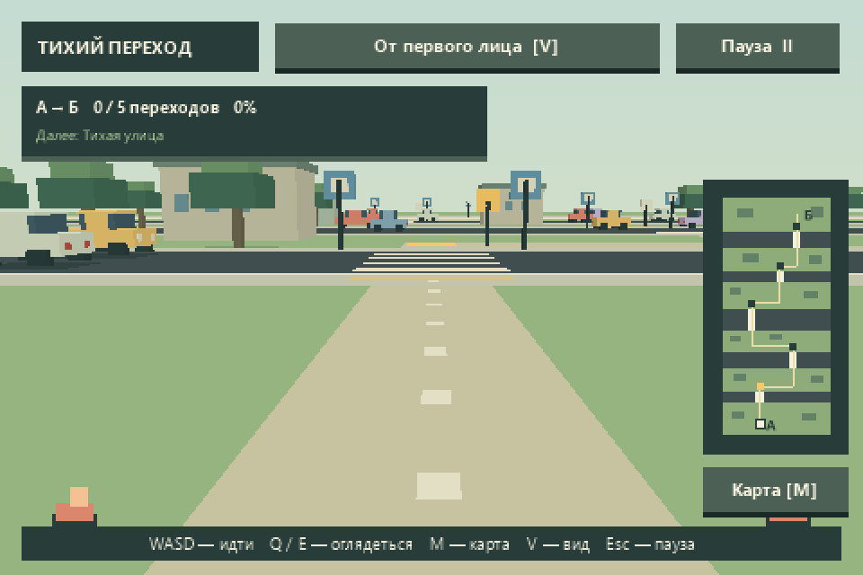
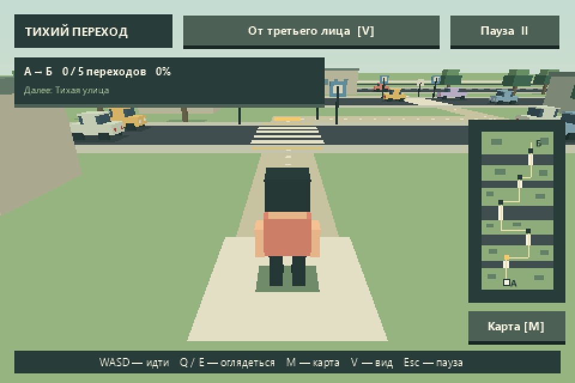

# Тихий переход

Пиксельная игра для Windows с мягкой палитрой: пройди через город от точки А до точки Б. На пути пять улиц с разным потоком машин, тротуары, скверы и повороты. Одно столкновение завершает попытку: весь маршрут нужно начать заново.

## Скачать и запустить

Установщик и переносимая версия доступны в [GitHub Releases](https://github.com/MaksimDenisov31/quiet-crossing/releases/latest). Установщик `QuietCrossing-Setup-1.2.0.exe` устанавливает игру для текущего пользователя без прав администратора. Для переносимой версии распакуй ZIP целиком и запусти `QuietCrossing.exe`.

Windows 10/11, .NET Framework 4.8 или новее (обычно уже установлен). Интернет для игры не нужен.

## Управление

| Действие | Клавиши |
| --- | --- |
| Идти | Стрелки или WASD |
| Пауза / продолжить | Esc или P |
| Открыть / закрыть карту | M или кнопка «Карта» |
| Переключить вид без перезапуска | V или кнопка вида вверху экрана |
| Посмотреть налево / направо в объёмных видах | Удерживать Q / E |
| Новая попытка после победы или столкновения | R |
| Выбрать пункт меню | Мышь, Tab или ↑ / ↓ |
| Подтвердить пункт | Enter или пробел |

После нажатия «Играть» выбери один из трёх видов: от первого лица, от третьего лица или с высоты птичьего полёта. Первое лицо показывает город с уровня глаз, третье — из-за спины персонажа; в виде сверху камера следует за игроком по большой карте. В объёмных видах Q/E позволяют оглядеться; после отпускания камера возвращается к направлению на север карты. W/↑ — вверх по карте, S/↓ — вниз, A/D — в стороны. Смена камеры не меняет положение, время, машины и результат текущей попытки.

## Маршрут А → Б

Карта размером 640 × 1420 игровых единиц: Тихая улица, Рыночная улица, Центральный проспект, Парковая улица и Набережная. На улицах от двух до четырёх полос; скорость и интервалы потока различаются. Пунктир на дорожках и мини-карта показывают путь с поворотами. Между дорогами можно спокойно остановиться. Дома нельзя проходить насквозь.

После каждой дороги дойди до пронумерованной отметки на противоположном тротуаре. Отметки засчитываются по порядку, повторное посещение одной отметки не увеличивает счётчик. Когда пройдены все пять переходов, дойди до площадки Б с флажками. Первый переход и даже пятый сами по себе ещё не завершают игру.

Справа всегда видна мини-карта с твоим положением, маршрутом и следующей отметкой. M открывает полную карту со списком улиц и примерным оставшимся расстоянием; игра при этом стоит на паузе. Прогресс наверху показывает путь до Б и число пройденных переходов. После столкновения новая попытка начинается в точке А; автоматического возрождения на отметках нет.

В настройках доступны камера, три плотности движения и включение звуков результата. Новая сложность применяется при следующем старте; камера меняется сразу, в том числе во время паузы. При потере фокуса игра сама ставится на паузу. В пределах карты можно свободно ходить по дорожкам, тротуарам и скверам.

Выбранная камера, настройки, число побед и размер окна сохраняются в `%LOCALAPPDATA%\QuietCrossing\settings.xml`. Установка обновлений и удаление приложения не удаляют этот файл. Настройки версий 1.0.0 и 1.1.0 продолжают работать; прежние победы не сбрасываются.

## Сборка

Проект не использует внешние библиотеки и сетевые зависимости. `Build.bat` собирает EXE встроенным компилятором .NET Framework. Для установщика нужен Inno Setup 6: запусти `BuildInstaller.bat` (можно передать полный путь к `ISCC.exe`). Для пересоздания иконки: `powershell -ExecutionPolicy Bypass -File tools\MakeIcon.ps1`.

Проверки из папки проекта: `QuietCrossing.exe --self-test` и `QuietCrossing.exe --ui-test`. Дождись завершения процесса и проверь код выхода; отчёты записываются в `test-results.txt` и `ui-test-results.txt`. UI-проверка использует отдельные настройки в памяти и не меняет пользовательские данные. `--preview` сохраняет четырнадцать изображений экранов и камер в `docs`.

## Версия 1.2.0

Вместо одного перехода — большая карта и маршрут А → Б через пять улиц. Добавлены повороты и скверы, разное количество полос и темп машин, отметки прохождения, дома с препятствиями, следящая камера сверху, мини-карта, большая карта на M и общий прогресс. Все три вида камеры и пользовательские настройки сохранены.

## Версия 1.1.0

Три режима камеры, экран выбора вида перед стартом, объёмная пиксельная сцена для первого и третьего лица, взгляд в стороны на Q/E, переключение камер на V, сохранение выбранного вида. Общая игровая логика, прежний вид сверху и пользовательские настройки сохранены. Для перспективных видов используется программная отрисовка с буфером глубины; внешние движки и дополнительные библиотеки не нужны.

## Версия 1.0.0

Первый выпуск: меню, настройки, четыре полосы случайного движения, столкновения, победа, повтор попытки, пауза и сохранение настроек. Все изображения нарисованы программно специально для этой игры; сторонние графические и звуковые ресурсы не используются.
