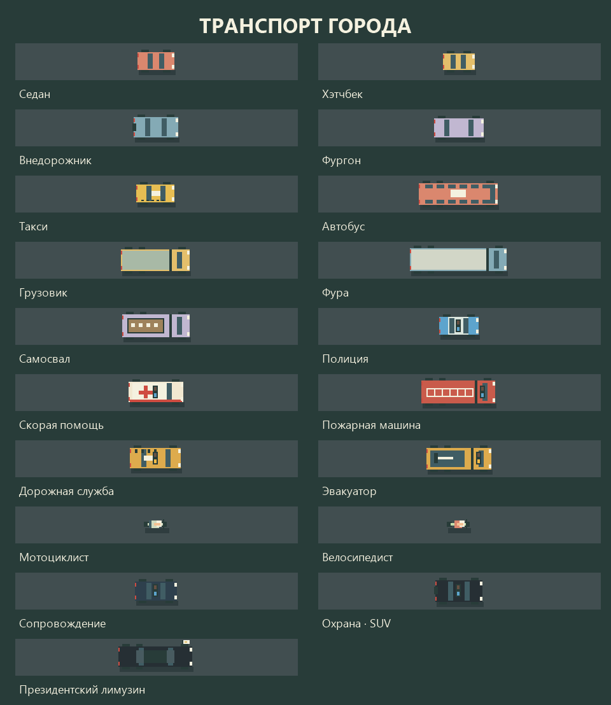
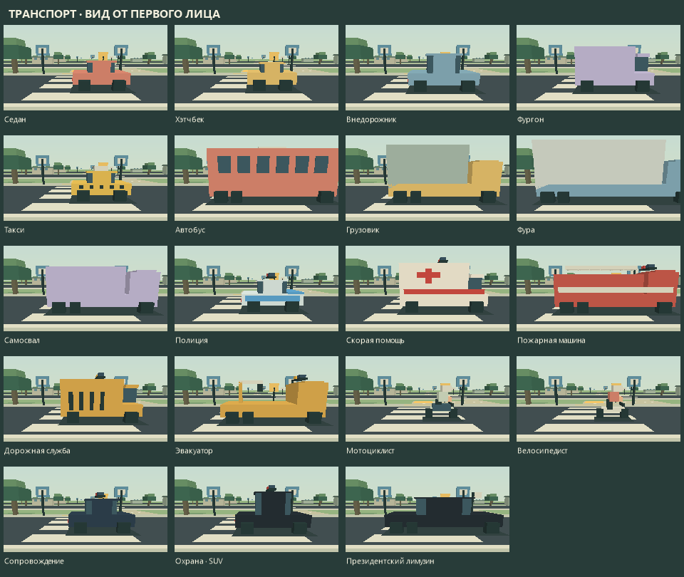
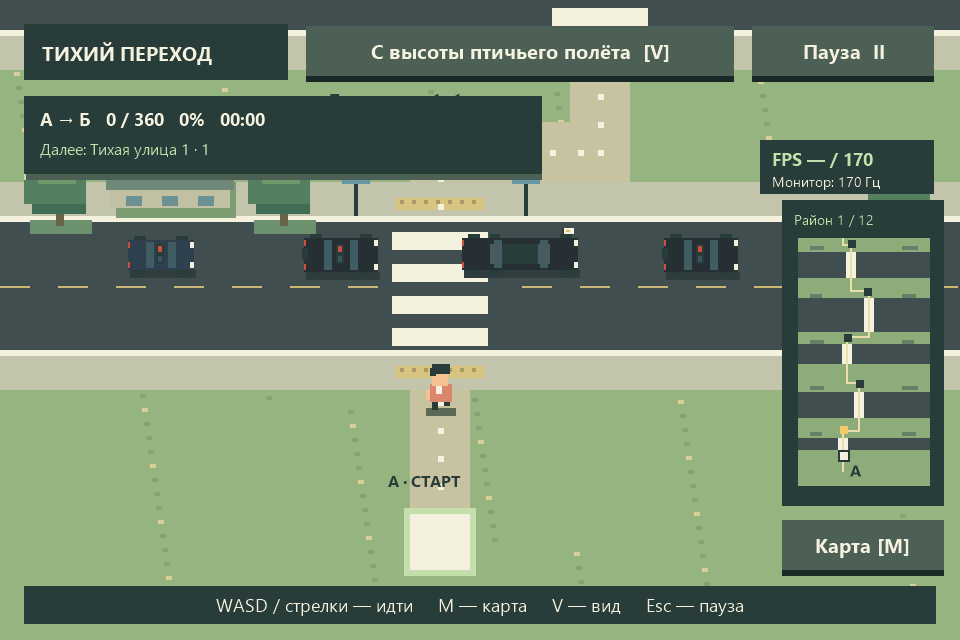
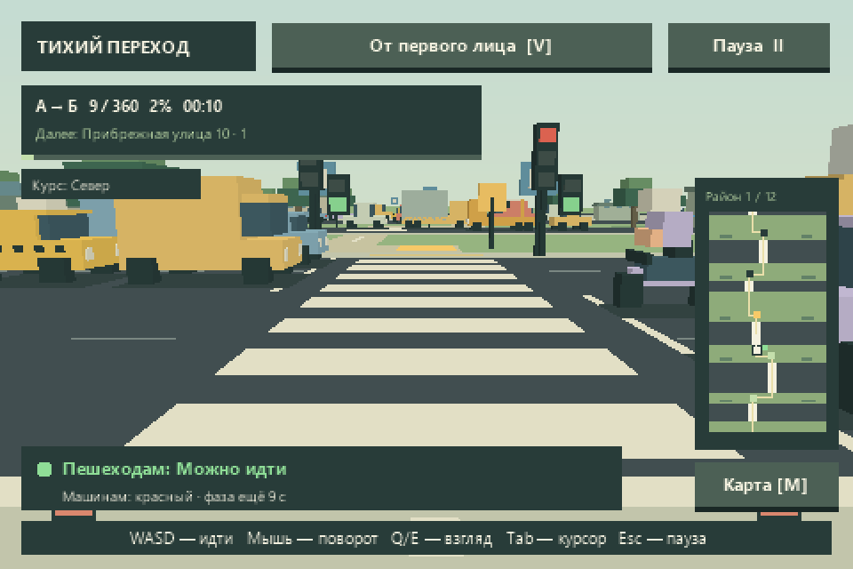
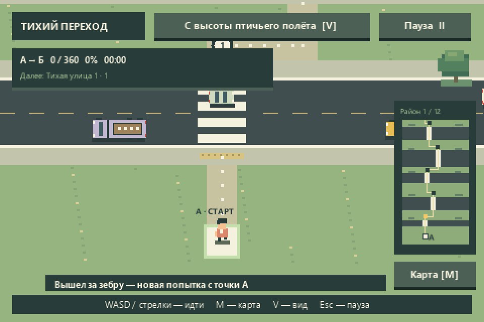
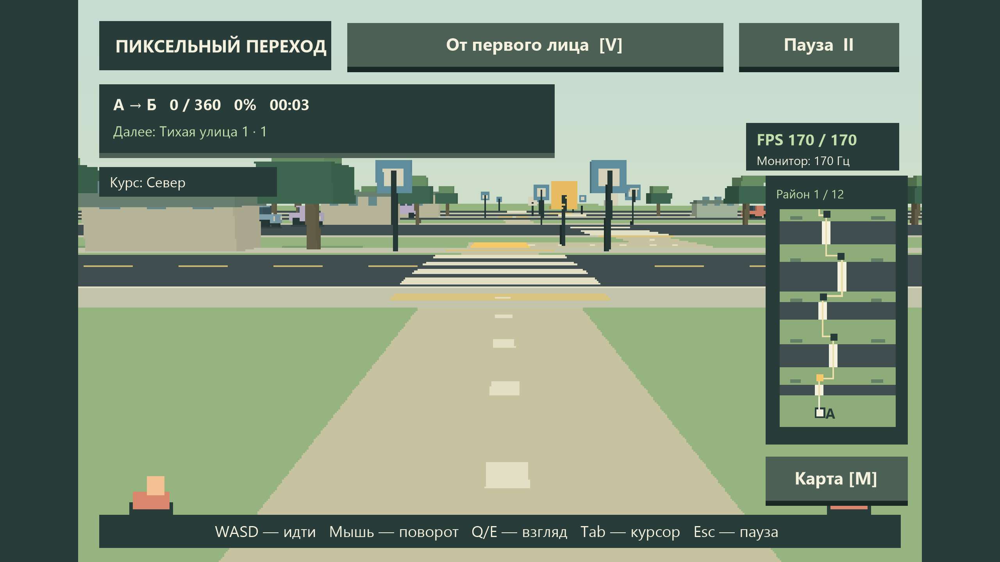

# пиксельный переход Игра

Пиксельная игра для Windows с мягкой палитрой: пройди большой город от точки А до точки Б. На пути 12 районов и 360 переходов с разным потоком машин, тротуары, скверы и повороты. Даже самый быстрый путь занимает больше 20 минут. Пронумерованные отметки сохраняют прогресс текущего забега: после ошибки можно продолжить от последней достигнутой точки.

## Скачать и запустить

Установщик и переносимая версия доступны в [GitHub Releases](https://github.com/MaksimDenisov31/quiet-crossing/releases/latest). Установщик `PixelCrossing-Setup-1.11.0.exe` устанавливает игру для текущего пользователя без прав администратора. Для переносимой версии распакуй ZIP целиком и запусти `пиксельный переход Игра.exe`.

Windows 10/11, .NET Framework 4.8 или новее (обычно уже установлен). Интернет для игры не нужен.

## Управление

| Действие | Клавиши |
| --- | --- |
| Идти в объёмных видах | W/S или ↑/↓ — вперёд/назад; A/D — в стороны |
| Пауза / продолжить | Esc или P |
| Открыть / закрыть карту | M или кнопка «Карта» |
| Переключить вид без перезапуска | V или кнопка вида вверху экрана |
| Повернуть персонажа в объёмных видах | Двигать мышь; запасное управление — ←/→ |
| Посмотреть влево / вправо без поворота тела | Удерживать Q/E; после отпускания взгляд возвращается |
| Освободить / захватить курсор во время игры | Tab; щелчок по свободной сцене также возвращает обзор |
| Идти в виде сверху | Стрелки или WASD по сторонам карты |
| Вернуться к контрольной точке после столкновения / новая игра после победы | R |
| Полный экран / оконный режим | F11 или Alt+Enter, также кнопка в настройках |
| Выбрать пункт меню | Мышь, Tab или ↑ / ↓ |
| Подтвердить пункт | Enter или пробел |

После нажатия «Играть» выбери один из трёх видов: от первого лица, от третьего лица или с высоты птичьего полёта. Первое лицо показывает город с уровня глаз, третье — из-за спины персонажа; в виде сверху камера следует за игроком по большой карте. В объёмных видах мышь автоматически управляет поворотом и взглядом вверх/вниз; кнопки мыши удерживать не нужно. Во время обзора курсор скрыт и остаётся внутри окна, горизонтальный поворот не ограничен краем экрана. W/↑ — вперёд относительно направления тела, S/↓ — назад, A/D — в стороны; ←/→ остаются запасным поворотом тела с клавиатуры.

Q/E временно поворачивают только голову влево/вправо. После отпускания взгляд плавно возвращается вперёд; движение по W во время такого взгляда сохраняет направление тела. На мини-карте белым отмечен курс тела, жёлтым — взгляд в сторону.

Tab освобождает курсор для кнопок интерфейса; повторный Tab или щелчок по свободной сцене возвращает обзор. Esc/P ставят игру на паузу, M открывает карту — в обоих случаях курсор становится обычным. Возврат в игру снова включает обзор. Потеря фокуса ставит игру на паузу и освобождает курсор, закрытие приложения восстанавливает его состояние. Смена камеры сохраняет поворот тела; в виде сверху управление остаётся по сторонам карты и курсор свободен.

## Транспорт и светофоры

В потоке 19 видов транспорта: седаны, хэтчбеки, внедорожники, фургоны, такси, автобусы, грузовики, фуры, самосвалы, полиция, скорая помощь, пожарные машины, дорожная служба, эвакуаторы, мотоциклисты и велосипедисты, а также машины сопровождения, охраны и президентский лимузин.

Модели различаются размерами, скоростью, силуэтами и деталями во всех трёх камерах. У спецслужб есть мигающие маячки, у пожарной машины — лестница, у самосвала — груз, у такси — шашечки. Велосипедисты и мотоциклисты изображены с ездоками и узкими колёсами. Президентский кортеж появляется как отдельная колонна из пяти машин: сопровождение, охрана, лимузин, охрана и замыкающее сопровождение. Обычный поток не вклинивается между участниками при формировании колонны. Машины держат дистанцию, следуют за медленным транспортом и собираются в очередь.

Ровно 18 из 360 переходов (5%) регулируются светофорами, распределёнными по карте. Для машин есть зелёный, жёлтый, красный и подготовительный красный с жёлтым; для пешеходов — красный и зелёный с миганием перед завершением. Стоп-линии, лампы и текущая фаза видны в мире, а подсказка у регулируемой зебры показывает, когда идти.

На красный пешеходный сигнал персонаж ждёт у бордюра, попытка не заканчивается. На зелёный можно начать переход; уже находящийся на дороге персонаж может закончить его и после смены сигнала. Между транспортной и пешеходной фазами есть время для освобождения дороги. Все виды транспорта, включая спецслужбы и кортеж, соблюдают сигналы. Машины, уже проехавшие стоп-линию, освобождают зебру. Правило полного выхода за боковую границу зебры продолжает действовать.

## Маршрут А → Б

Карта размером 640 × 80956 игровых единиц: 12 районов, от Стартового квартала через Старый город, сады, университет и Сосновый парк до Набережной. В каждом районе 30 улиц, всего 360 переходов. На улицах от двух до пяти полос; скорость и интервалы потока различаются. Пунктир на дорожках и мини-карта показывают путь с поворотами. Между дорогами можно спокойно остановиться. Дома нельзя проходить насквозь.

Дороги стоят в шесть раз ближе друг к другу, чем в версии 1.3.0: шаг между улицами уменьшен с 1344 до 224 единиц. Безопасные промежутки между проезжими частями — 64–160 единиц, боковые перемещения между зебрами — максимум 100 единиц (около 1,6 секунды ходьбы). Время длинного маршрута сохранено за счёт количества дорог с машинами, а не длинных пустых прогулок.
На проезжей части нужно оставаться на зебре. Частичный выход за её боковой край разрешён: пока хоть небольшая часть персонажа касается перехода, попытка продолжается. Полный выход за боковую границу возвращает к последней контрольной точке и открывает заметное окно «За зебру выходить нельзя». Игра стоит на паузе, курсор освобождается; нажми «Понятно — продолжить», Enter, пробел или Esc, чтобы продолжить. До первой отметки возвращение происходит к А. Касание самой границы разрешено, промежутки между белыми полосами считаются частью перехода. На тротуарах можно свободно ходить и поворачивать; нормальный выход с зебры на противоположный тротуар не штрафуется. Правило одинаково во всех трёх видах камеры. Столкновение с машиной открывает экран поражения; «Ещё раз» или R возвращает к последней контрольной точке.
После каждой дороги дойди до пронумерованной отметки на противоположном тротуаре. Отметки засчитываются по порядку, повторное посещение одной отметки не увеличивает счётчик. Когда пройдены все 360 переходов, дойди до площадки Б с флажками. Последний переход сам по себе ещё не завершает игру.

Справа всегда видна карта ближайших улиц с твоим положением, маршрутом и следующей отметкой. M открывает схему всех 12 районов и ближайшие пять улиц текущего района; кнопка «Район» переключает её на местную карту, «Весь путь» возвращает схему города. Игра при этом стоит на паузе. Наверху показаны прогресс, число пройденных переходов и время попытки. При возвращении к отметке время, счётчик пройденных дорог и движение машин сохраняются. Контрольные точки действуют в текущем забеге; новый запуск через главное меню начинает маршрут с А.

### Почему нельзя пройти быстрее 20 минут

Скорость персонажа — максимум 64 игровые единицы в секунду; диагональное движение не ускоряет его. Разница координат старта и финиша по вертикали составляет 80676 единиц. Даже с учётом допуска 20 единиц на финише и при полном игнорировании дорог, домов, поворотов и отметок нижняя граница времени составляет `(80676 − 20) / 64 = 1260,25 секунды`, то есть **21 минута 0,25 секунды**. Срезание углов не отменяет необходимость пройти это расстояние по вертикали.

Длина размеченного маршрута — 106556 единиц: около **27 минут 45 секунд** чистого движения. Регулируемые переходы добавляют ожидание пешеходного зелёного. Автоматический проход без машин с работающими светофорами занял около **29 минут**; живой поток и паузы могут увеличить это время. Финиш не блокируется таймером: продолжительность достигается длиной карты, без искусственного ожидания.

В настройках доступны камера, три плотности движения и включение звуков результата. Новая сложность применяется при следующем старте; камера меняется сразу, в том числе во время паузы. При потере фокуса игра сама ставится на паузу. В пределах карты можно свободно ходить по дорожкам, тротуарам и скверам.

Выбранная камера, настройки, число побед, полноэкранный режим и размер обычного окна сохраняются в `%LOCALAPPDATA%\QuietCrossing\settings.xml`. Установка обновлений и удаление приложения не удаляют этот файл. Настройки предыдущих версий продолжают работать; прежние победы не сбрасываются.

## Сборка

Проект не использует внешние библиотеки и сетевые зависимости. `Build.bat` собирает EXE встроенным компилятором .NET Framework. Для установщика нужен Inno Setup 6: запусти `BuildInstaller.bat` (можно передать полный путь к `ISCC.exe`). Для пересоздания иконки: `powershell -ExecutionPolicy Bypass -File tools\MakeIcon.ps1`.

Проверки из папки проекта: `& '.\пиксельный переход Игра.exe' --self-test`, `& '.\пиксельный переход Игра.exe' --ui-test` и `& '.\пиксельный переход Игра.exe' --pointer-test`. Дождись завершения процесса и проверь код выхода; отчёты записываются в `test-results.txt`, `ui-test-results.txt` и `pointer-test-results.txt`. `--display-test` проверяет полноэкранный режим и реальную частоту кадров; `--benchmark` измеряет время отрисовки и симуляции, отчёты — `display-test-results.txt` и `benchmark-results.txt`. UI-проверка использует отдельные настройки в памяти и не меняет пользовательские данные. `--preview` сохраняет 29 изображений экранов и камер и две галереи транспорта в `docs`.

Проверка `--pointer-test` дополнительно проверяет реальный захват, скрытие и освобождение системного курсора Windows, изменение границ при размере окна и восстановление исходной области курсора. Настройки пользователя не изменяются.

## Версия 1.11.0

Переработано управление мышью в видах от первого и третьего лица. Накопившиеся Raw Input события читаются пакетами и перед кадром, а дублирующие обычные сообщения мыши отключены на время захвата. Для абсолютных устройств (например, некоторых удалённых рабочих столов) координаты обрабатываются напрямую: первый пакет устанавливает исходную точку, курсор не перецентрируется на каждом движении. Отпускание курсора и пауза очищают накопленный ввод. Ограничение курсора обновляется только при изменении границ или его сбросе Windows.

Поворот по умолчанию менее резкий. В настройках появилась чувствительность мыши: «Низкая», «Средняя», «Высокая», выбор сохраняется. Обе оси используют согласованную чувствительность; запасное управление обычными сообщениями не зависит от размера окна. Сглаживание с задержкой не добавлялось. Вид сверху, движение, Q/E, контрольные точки и другие игровые функции сохранены.

Добавлен `--motion-test`: полноэкранные повороты и вертикальный взгляд с синтетическим потоком пакетов 1000 и 8000 Гц в обоих объёмных видах. Отчёт `motion-test-results.txt` содержит FPS и медиану / p95 / p99 / максимум интервалов кадров. Это автоматическая нагрузка на обработчик, а не проверка физической мыши на 8000 Гц. В коротком прогоне получены примерно 154–157 FPS и p95 менее 8 мс; единичная стартовая пауза около 38 мс сохранялась. Отсутствие рывков на любом устройстве не гарантируется.

Обработка очереди следует [рекомендованному Microsoft сочетанию GetRawInputData и GetRawInputBuffer](https://learn.microsoft.com/en-us/windows/win32/inputdev/using-raw-input); формат абсолютных координат — [RAWMOUSE](https://learn.microsoft.com/en-us/windows/win32/api/winuser/ns-winuser-rawmouse).

## Версия 1.10.1

Папка проекта и исполняемый файл переименованы: `пиксельный переход Игра\пиксельный переход Игра.exe`. Обновлены имя окна, меню, свойства EXE, ярлыки, установщик и команды сборки. Прежний репозиторий, история и AppId установщика сохранены. Настройки остаются в `%LOCALAPPDATA%\QuietCrossing\settings.xml`, поэтому камера, полноэкранный режим, размеры окна и победы не сбрасываются. При обновлении в прежнюю папку старые EXE и конфигурация заменяются новыми именами; новая установка предлагает папку `%LOCALAPPDATA%\Programs\пиксельный переход Игра`.

В PowerShell имена с пробелами запускаются через оператор `&`: `& '.\пиксельный переход Игра.exe' --self-test`.

## Версия 1.10.0

FPS автоматически подстраивается под текущую частоту монитора в Windows: 120 Гц — цель 120 FPS, 170 Гц — цель 170 FPS, аналогично для других частот. Показатель «FPS X / Y» показывает реальную частоту кадров и выбранную цель; ниже указаны герцы текущего экрана. Игра перечитывает параметры при переносе окна, изменении режима дисплея и примерно раз в секунду. Если драйвер не сообщает частоту, используется запасная цель 60 FPS. Настройки самого монитора игра не меняет. Фактическая частота кадров зависит от компьютера и нагрузки.

Вместо оконного таймера работает отдельный планировщик с высокоточным ожиданием; очередь устаревших кадров не накапливается. Ускорены масштабирование пиксельной сцены, вывод готового кадра, повторное использование шрифтов и отрисовка видимых граней объёмных объектов. Пиксельные персонаж, транспорт и окружение, сглаженный текст, контрольные точки и предупреждение о зебре сохранены.

В коротком тесте на экране 2560 × 1440 при 170 Гц получены примерно 166–169 FPS во всех трёх камерах; при тестовой цели 120 — около 120 FPS. Тестовая цель проверена без изменения настроек Windows. Это замеры конкретного компьютера, а не гарантия для других устройств.

Для чтения текущего режима применяется [EnumDisplaySettingsExW](https://learn.microsoft.com/en-us/windows/win32/api/winuser/nf-winuser-enumdisplaysettingsexw); высокоточное ожидание использует [CreateWaitableTimerExW](https://learn.microsoft.com/en-us/windows/win32/api/synchapi/nf-synchapi-createwaitabletimerexw), с запасным способом для старых Windows 10.

## Версия 1.9.0

Добавлено отдельное окно предупреждения «За зебру выходить нельзя»: оно объясняет правило и возврат к последней контрольной точке, останавливает движение и освобождает курсор до подтверждения. Частичный выход за край по-прежнему разрешён.

Весь текст — меню, кнопки, карта, отметки, подсказки и FPS — рисуется сглаженным шрифтом Segoe UI в разрешении окна. Машины, персонаж и окружение остаются пиксельными. Текст больше не увеличивается вместе с пиксельным кадром; маски интерфейса и границы мини-карты учитываются отдельно.

## Версия 1.8.0

Полноэкранный режим по умолчанию, переключение F11 / Alt+Enter и в настройках. Размер обычного окна хранится отдельно; выбор режима восстанавливается при запуске. Изображение сохраняет пропорции и чёткие пиксели, на широких экранах по бокам остаются поля. FPS показывает реально нарисованные кадры и обновляется дважды в секунду. Целевая частота — 60 кадров в секунду. Ускорена отрисовка треугольников объёмной сцены и улучшен таймер кадров.

Пронумерованные точки стали контрольными: полный выход за зебру автоматически возвращает к последней отметке, после столкновения туда возвращают R или «Ещё раз». Частичное пересечение края зебры разрешено. Прогресс, время забега, сложность и движение машин сохраняются. До первой отметки возрождение происходит на старте А. Контрольные точки хранятся только в текущем забеге.

## Версия 1.7.0

19 разных моделей транспорта, ездоки на велосипедах и мотоциклах, отдельный президентский кортеж из пяти автомобилей. Машины учитывают собственные размеры, тормозят, держат дистанцию и следуют за медленным транспортом. На 18 переходах из 360 добавлены светофоры с отдельной пешеходной фазой, стоп-линиями и очередями. На красный персонаж ждёт на тротуаре без проигрыша. Настройки, свободный обзор мышью, временный взгляд Q/E и правила зебры сохранены.

## Версия 1.6.0

Мышь управляет поворотом и вертикальным взглядом без ПКМ. Q/E теперь временно поворачивают голову, не меняя движение и курс тела. Добавлены автоматический захват курсора в объёмных видах, освобождение по Tab и при паузе/карте/потере фокуса, восстановление системного курсора при выходе. На мини-карте отдельно показаны курс и взгляд. Маршрут, правила зебры, три камеры и пользовательские настройки сохранены.

## Версия 1.5.0

Обязательный переход дороги по зебре: полный выход персонажа за боковую границу на проезжей части возвращает в А. Частичное пересечение края и касание границы допустимы. На тротуарах ограничений нет. Возврат автоматический с пояснением причины, камера, сложность и настройки сохранены. Контроль работает в мировых координатах одинаково во всех трёх видах.

## Версия 1.4.0

Постоянный поворот Q/E или стрелками и правой кнопкой мыши, движение W/S относительно взгляда, поворот модели персонажа в третьем лице. Направление сохраняется при смене камеры, на карте и паузе. На мини-карте добавлен указатель взгляда. Дороги расположены в шесть раз плотнее, длинные боковые прогулки сокращены до 100 единиц, улицы получили 2–5 полос. Минимум 20 минут сохранён: теперь это 360 близко расположенных переходов в 12 районах. Все пользовательские настройки сохранены.

## Версия 1.3.0

Город расширен до 12 районов и 60 переходов. Доказанная нижняя граница прохождения — 21:18 даже со срезами, размеченный маршрут без транспорта — около 29:20. Добавлены счётчик времени, схема всех районов и местная карта. Транспорт и отрисовка обрабатывают ближайшие участки города; удаление дальних машин предотвращает накопление объектов при перемещении по карте. Точность координат и времени увеличена для длинных попыток. Все три камеры и пользовательские настройки сохранены.

## Версия 1.2.0

Вместо одного перехода — большая карта и маршрут А → Б через пять улиц. Добавлены повороты и скверы, разное количество полос и темп машин, отметки прохождения, дома с препятствиями, следящая камера сверху, мини-карта, большая карта на M и общий прогресс. Все три вида камеры и пользовательские настройки сохранены.

## Версия 1.1.0

Три режима камеры, экран выбора вида перед стартом, объёмная пиксельная сцена для первого и третьего лица, взгляд в стороны на Q/E, переключение камер на V, сохранение выбранного вида. Общая игровая логика, прежний вид сверху и пользовательские настройки сохранены. Для перспективных видов используется программная отрисовка с буфером глубины; внешние движки и дополнительные библиотеки не нужны.

## Версия 1.0.0

Первый выпуск: меню, настройки, четыре полосы случайного движения, столкновения, победа, повтор попытки, пауза и сохранение настроек. Все изображения нарисованы программно специально для этой игры; сторонние графические и звуковые ресурсы не используются.
