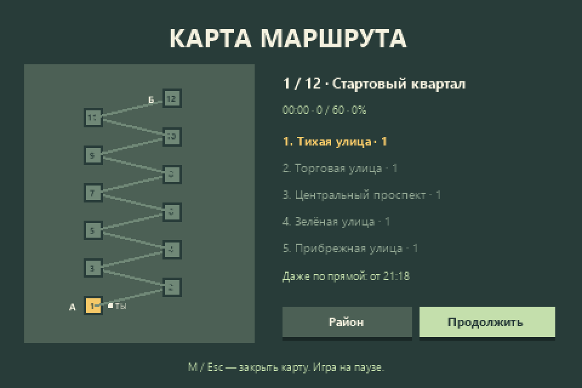
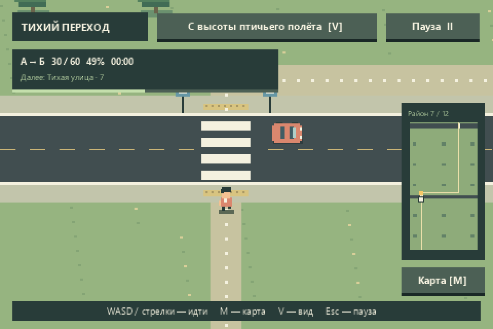

# Тихий переход

Пиксельная игра для Windows с мягкой палитрой: пройди большой город от точки А до точки Б. На пути 12 районов и 360 переходов с разным потоком машин, тротуары, скверы и повороты. Даже самый быстрый путь занимает больше 20 минут. Одно столкновение завершает попытку: весь маршрут нужно начать заново.

## Скачать и запустить

Установщик и переносимая версия доступны в [GitHub Releases](https://github.com/MaksimDenisov31/quiet-crossing/releases/latest). Установщик `QuietCrossing-Setup-1.5.0.exe` устанавливает игру для текущего пользователя без прав администратора. Для переносимой версии распакуй ZIP целиком и запусти `QuietCrossing.exe`.

Windows 10/11, .NET Framework 4.8 или новее (обычно уже установлен). Интернет для игры не нужен.

## Управление

| Действие | Клавиши |
| --- | --- |
| Идти в объёмных видах | W/S или ↑/↓ — вперёд/назад; A/D — в стороны |
| Пауза / продолжить | Esc или P |
| Открыть / закрыть карту | M или кнопка «Карта» |
| Переключить вид без перезапуска | V или кнопка вида вверху экрана |
| Повернуть налево / направо в объёмных видах | Q/E или ←/→ |
| Повернуться мышью | Удерживать правую кнопку и двигать мышь влево/вправо |
| Идти в виде сверху | Стрелки или WASD по сторонам карты |
| Новая попытка после победы или столкновения | R |
| Выбрать пункт меню | Мышь, Tab или ↑ / ↓ |
| Подтвердить пункт | Enter или пробел |

После нажатия «Играть» выбери один из трёх видов: от первого лица, от третьего лица или с высоты птичьего полёта. Первое лицо показывает город с уровня глаз, третье — из-за спины персонажа; в виде сверху камера следует за игроком по большой карте. В объёмных видах поворот постоянный: после отпускания Q/E камера сохраняет направление. Чтобы повернуть направо после перехода, удерживай E или →, отпусти на нужном направлении и нажми W — персонаж пойдёт туда, куда смотрит. Мышью можно поворачиваться на 360°, удерживая правую кнопку. W/↑ — вперёд относительно взгляда, S/↓ — назад, A/D — в стороны относительно взгляда. В виде сверху управление остаётся по сторонам карты. На мини-карте отмечено направление взгляда, рядом с прогрессом показана сторона света. Смена камеры, карта и пауза сохраняют направление; новая попытка начинает взгляд на север. При открытии карты, паузы или потере фокуса перетаскивание мышью прекращается.

## Маршрут А → Б

Карта размером 640 × 80956 игровых единиц: 12 районов, от Стартового квартала через Старый город, сады, университет и Сосновый парк до Набережной. В каждом районе 30 улиц, всего 360 переходов. На улицах от двух до пяти полос; скорость и интервалы потока различаются. Пунктир на дорожках и мини-карта показывают путь с поворотами. Между дорогами можно спокойно остановиться. Дома нельзя проходить насквозь.

Дороги стоят в шесть раз ближе друг к другу, чем в версии 1.3.0: шаг между улицами уменьшен с 1344 до 224 единиц. Безопасные промежутки между проезжими частями — 64–160 единиц, боковые перемещения между зебрами — максимум 100 единиц (около 1,6 секунды ходьбы). Время длинного маршрута сохранено за счёт количества дорог с машинами, а не длинных пустых прогулок.
На проезжей части нужно оставаться на зебре. Частичный выход за её боковой край разрешён: пока хоть небольшая часть персонажа касается перехода, попытка продолжается. Полный выход за боковую границу автоматически начинает весь маршрут заново с точки А; появляется короткое сообщение о причине. Касание самой границы разрешено, промежутки между белыми полосами считаются частью перехода. На тротуарах можно свободно ходить и поворачивать; нормальный выход с зебры на противоположный тротуар не штрафуется. Правило одинаково во всех трёх видах камеры. Столкновение с машиной по-прежнему открывает экран поражения.
После каждой дороги дойди до пронумерованной отметки на противоположном тротуаре. Отметки засчитываются по порядку, повторное посещение одной отметки не увеличивает счётчик. Когда пройдены все 360 переходов, дойди до площадки Б с флажками. Последний переход сам по себе ещё не завершает игру.

Справа всегда видна карта ближайших улиц с твоим положением, маршрутом и следующей отметкой. M открывает схему всех 12 районов и ближайшие пять улиц текущего района; кнопка «Район» переключает её на местную карту, «Весь путь» возвращает схему города. Игра при этом стоит на паузе. Наверху показаны прогресс, число пройденных переходов и время попытки. После столкновения новая попытка начинается в точке А; автоматического возрождения на отметках нет.

### Почему нельзя пройти быстрее 20 минут

Скорость персонажа — максимум 64 игровые единицы в секунду; диагональное движение не ускоряет его. Разница координат старта и финиша по вертикали составляет 80676 единиц. Даже с учётом допуска 20 единиц на финише и при полном игнорировании дорог, домов, поворотов и отметок нижняя граница времени составляет `(80676 − 20) / 64 = 1260,25 секунды`, то есть **21 минута 0,25 секунды**. Срезание углов не отменяет необходимость пройти это расстояние по вертикали.

Длина размеченного маршрута — 106556 единиц: около **27 минут 45 секунд** непрерывного движения без машин и остановок. Автоматическая симуляция полного маршрута подтвердила эту длительность и возможность дойти до Б. Машины и паузы увеличивают время. Финиш не блокируется таймером: продолжительность достигается длиной карты, без искусственного ожидания.

В настройках доступны камера, три плотности движения и включение звуков результата. Новая сложность применяется при следующем старте; камера меняется сразу, в том числе во время паузы. При потере фокуса игра сама ставится на паузу. В пределах карты можно свободно ходить по дорожкам, тротуарам и скверам.

Выбранная камера, настройки, число побед и размер окна сохраняются в `%LOCALAPPDATA%\QuietCrossing\settings.xml`. Установка обновлений и удаление приложения не удаляют этот файл. Настройки предыдущих версий продолжают работать; прежние победы не сбрасываются.

## Сборка

Проект не использует внешние библиотеки и сетевые зависимости. `Build.bat` собирает EXE встроенным компилятором .NET Framework. Для установщика нужен Inno Setup 6: запусти `BuildInstaller.bat` (можно передать полный путь к `ISCC.exe`). Для пересоздания иконки: `powershell -ExecutionPolicy Bypass -File tools\MakeIcon.ps1`.

Проверки из папки проекта: `QuietCrossing.exe --self-test` и `QuietCrossing.exe --ui-test`. Дождись завершения процесса и проверь код выхода; отчёты записываются в `test-results.txt` и `ui-test-results.txt`. UI-проверка использует отдельные настройки в памяти и не меняет пользовательские данные. `--preview` сохраняет восемнадцать изображений экранов и камер в `docs`.

## Версия 1.5.0

Обязательный переход дороги по зебре: полный выход персонажа за боковую границу на проезжей части возвращает в А. Частичное пересечение края и касание границы допустимы. На тротуарах ограничений нет. Возврат автоматический с пояснением причины, камера, сложность и настройки сохранены. Контроль работает в мировых координатах одинаково во всех трёх видах.

## Версия 1.4.0

Постоянный поворот Q/E или стрелками и правой кнопкой мыши, движение W/S относительно взгляда, поворот модели персонажа в третьем лице. Направление сохраняется при смене камеры, на карте и паузе. На мини-карте добавлен указатель взгляда. Дороги расположены в шесть раз плотнее, длинные боковые прогулки сокращены до 100 единиц, улицы получили 2–5 полос. Минимум 20 минут сохранён: теперь это 360 близко расположенных переходов в 12 районах. Все пользовательские настройки сохранены.

## Версия 1.3.0

Город расширен до 12 районов и 60 переходов. Доказанная нижняя граница прохождения — 21:18 даже со срезами, размеченный маршрут без транспорта — около 29:20. Добавлены счётчик времени, схема всех районов и местная карта. Транспорт и отрисовка обрабатывают ближайшие участки города; удаление дальних машин предотвращает накопление объектов при перемещении по карте. Точность координат и времени увеличена для длинных попыток. Все три камеры и пользовательские настройки сохранены.

## Версия 1.2.0

Вместо одного перехода — большая карта и маршрут А → Б через пять улиц. Добавлены повороты и скверы, разное количество полос и темп машин, отметки прохождения, дома с препятствиями, следящая камера сверху, мини-карта, большая карта на M и общий прогресс. Все три вида камеры и пользовательские настройки сохранены.

## Версия 1.1.0

Три режима камеры, экран выбора вида перед стартом, объёмная пиксельная сцена для первого и третьего лица, взгляд в стороны на Q/E, переключение камер на V, сохранение выбранного вида. Общая игровая логика, прежний вид сверху и пользовательские настройки сохранены. Для перспективных видов используется программная отрисовка с буфером глубины; внешние движки и дополнительные библиотеки не нужны.

## Версия 1.0.0

Первый выпуск: меню, настройки, четыре полосы случайного движения, столкновения, победа, повтор попытки, пауза и сохранение настроек. Все изображения нарисованы программно специально для этой игры; сторонние графические и звуковые ресурсы не используются.
