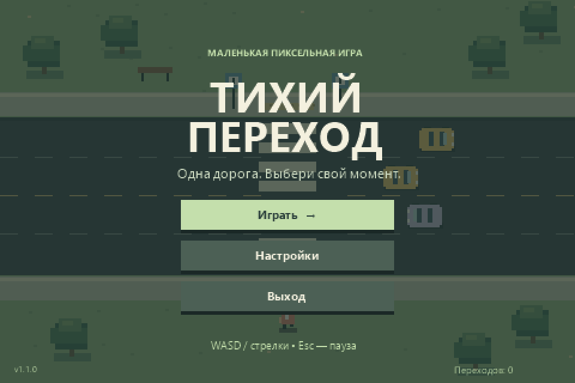

# Тихий переход

Небольшая игра для Windows с мягкой пиксельной палитрой. Дождись просвета в потоке машин и проведи человечка по зебре на другой тротуар. Одно столкновение завершает попытку, после него можно сразу начать заново.

## Скачать и запустить

Установщик и переносимая версия доступны в [GitHub Releases](https://github.com/MaksimDenisov31/quiet-crossing/releases/latest). Установщик `QuietCrossing-Setup-1.1.0.exe` устанавливает игру для текущего пользователя без прав администратора. Для переносимой версии распакуй ZIP целиком и запусти `QuietCrossing.exe`.

Windows 10/11, .NET Framework 4.8 или новее (обычно уже установлен). Интернет для игры не нужен.

## Управление

| Действие | Клавиши |
| --- | --- |
| Идти | Стрелки или WASD |
| Пауза / продолжить | Esc или P |
| Переключить вид без перезапуска | V или кнопка вида вверху экрана |
| Посмотреть налево / направо в объёмных видах | Удерживать Q / E |
| Новая попытка после победы или столкновения | R |
| Выбрать пункт меню | Мышь, Tab или ↑ / ↓ |
| Подтвердить пункт | Enter или пробел |

После нажатия «Играть» выбери один из трёх видов: от первого лица, от третьего лица или с высоты птичьего полёта. Первое лицо показывает дорогу с уровня глаз, третье — из-за спины персонажа, а вид сверху сохраняет исходное оформление игры. В объёмных видах Q/E поворачивают голову в стороны; после отпускания камера возвращается к переходу. Направление движения остаётся вдоль зебры: W/↑ — к финишу, S/↓ — назад, A/D — в стороны. Смена камеры не меняет положение, время, машины и результат текущей попытки.

В настройках доступны камера, три плотности движения и включение звуков результата. Новая сложность применяется при следующем старте; камера меняется сразу, в том числе во время паузы. При потере фокуса игра сама ставится на паузу. Положение игрока ограничено областью перехода; идти можно вперёд, назад и в стороны.

Выбранная камера, настройки, количество успешных переходов и размер окна сохраняются в `%LOCALAPPDATA%\QuietCrossing\settings.xml`. Установка обновлений и удаление приложения не удаляют этот файл. Настройки версии 1.0.0 продолжают работать; для них исходным видом остаётся вид сверху.

## Сборка

Проект не использует внешние библиотеки и сетевые зависимости. `Build.bat` собирает EXE встроенным компилятором .NET Framework. Для установщика нужен Inno Setup 6: запусти `BuildInstaller.bat` (можно передать полный путь к `ISCC.exe`). Для пересоздания иконки: `powershell -ExecutionPolicy Bypass -File tools\MakeIcon.ps1`.

Проверки из папки проекта: `QuietCrossing.exe --self-test` и `QuietCrossing.exe --ui-test`. Дождись завершения процесса и проверь код выхода; отчёты записываются в `test-results.txt` и `ui-test-results.txt`. UI-проверка использует отдельные настройки в памяти и не меняет пользовательские данные. `--preview` сохраняет двенадцать изображений экранов и камер в `docs`.

## Версия 1.1.0

Три режима камеры, экран выбора вида перед стартом, объёмная пиксельная сцена для первого и третьего лица, взгляд в стороны на Q/E, переключение камер на V, сохранение выбранного вида. Общая игровая логика, прежний вид сверху и пользовательские настройки сохранены. Для перспективных видов используется программная отрисовка с буфером глубины; внешние движки и дополнительные библиотеки не нужны.

## Версия 1.0.0

Первый выпуск: меню, настройки, четыре полосы случайного движения, столкновения, победа, повтор попытки, пауза и сохранение настроек. Все изображения нарисованы программно специально для этой игры; сторонние графические и звуковые ресурсы не используются.
